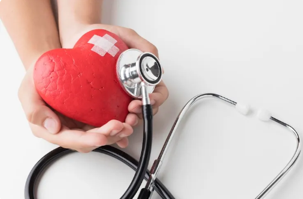
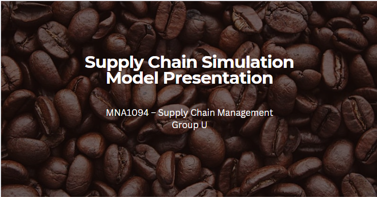
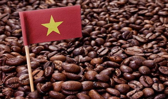
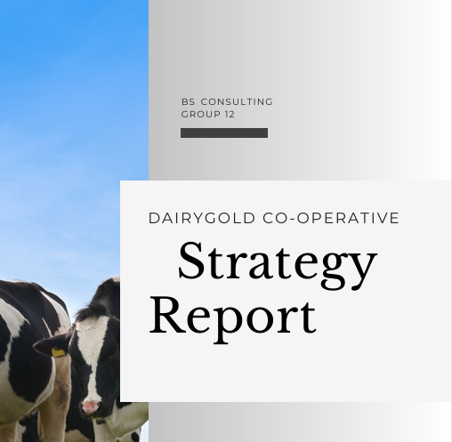
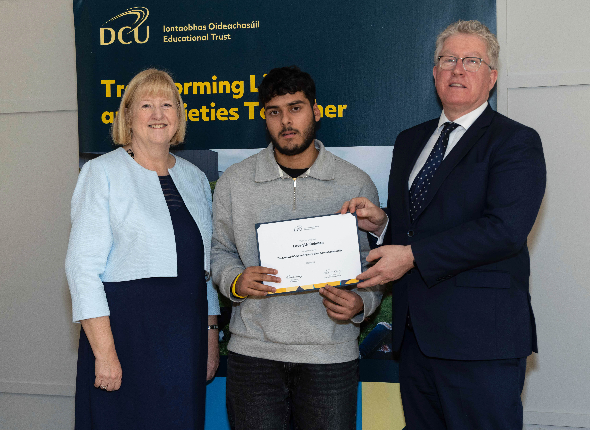
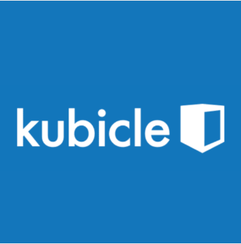

```{=html}
<div class="pf pf--academic">

<header class="pf-head">
  <div class="pf-title" role="heading" aria-level="1">Academic</div>
  <p class="pf-lede">
    I graduated from Dublin City University with a 2.1 honours degree in Business Studies, specialising in Data Analytics.
    These projects show how I combine business thinking with technical skills.
  </p>
</header>

<h2>Projects</h2>

<article class="pf-row">
  <a href="pdfs/ML_Report.pdf" target="_blank"></a>
  <div>
    <h3>Predicting Heart Disease Using Machine Learning</h3>
    <div class="pf-meta">Individual project. Python, Logistic Regression, SVM, Random Forest.</div>
    <p>
      I built and evaluated classification models on the Cleveland dataset and compared them on F1 score, recall and ROC AUC.
      The focus was balancing predictive accuracy with interpretability, backed by a 3,000-word reflective report
      covering methodology, KPI analysis and the ethics of AI in healthcare.
    </p>
    <div class="pf-links"><a href="pdfs/ML_Report.pdf" target="_blank">Read the report</a></div>
  </div>
</article>

<article class="pf-row">
  <a href="pdfs/Vietnamese-sim.pdf" target="_blank"></a>
  <div>
    <h3>Vietnamese Coffee Supply Chain Simulation</h3>
    <div class="pf-meta">Python (Spyder), simulation modelling.</div>
    <p>
      I developed a simulation model for Vietnamese coffee supply chain management and ran tests to see how events
      such as prolonged monsoons could affect production.
    </p>
    <div class="pf-links">
      <a href="pdfs/Vietnamese-sim.pdf" target="_blank">Read the report</a>
      <a href="projects/coffee-sim.qmd">View the code</a>
    </div>
  </div>
</article>

<article class="pf-row">
  <a href="pdfs/Vietnamese-coffee.pdf" target="_blank"></a>
  <div>
    <h3>Vietnamese Coffee Supply Chain Production</h3>
    <div class="pf-meta">Team project. Supply chain analysis, sustainability.</div>
    <p>
      We analysed sourcing, production costs and sustainability across the Vietnamese coffee supply chain, then
      recommended ways to improve efficiency, quality and environmental responsibility.
    </p>
    <div class="pf-links"><a href="pdfs/Vietnamese-coffee.pdf" target="_blank">Read the report</a></div>
  </div>
</article>

<article class="pf-row">
  <a href="pdfs/Dairygold.pdf" target="_blank"></a>
  <div>
    <h3>Dairy Gold Strategy</h3>
    <div class="pf-meta">Team project. Strategy, brand and market analysis.</div>
    <p>
      We carried out a strategic analysis of Dairy Gold's market position, supply chain efficiency and brand value,
      and recommended actions to compete better in a crowded market.
    </p>
    <div class="pf-links"><a href="pdfs/Dairygold.pdf" target="_blank">Read the report</a></div>
  </div>
</article>

<p>
  Looking for a venture-style project? <a href="entrepreneurship.qmd">WaterWize</a>, our NED project, is on the Entrepreneurship page.
</p>

<h2>Toolkit</h2>

<p class="pf-toolkit">
  <span>Microsoft Excel</span>
  <span>SQL</span>
  <span>Python</span>
  <span>Tableau</span>
  <span>Power BI</span>
  <span>Scikit-Learn</span>
  <span>HTML, CSS and JavaScript</span>
</p>
<p><a href="Skills.qmd">See all my skills</a></p>

<h2>Recognition and certificates</h2>

<div class="pf-feature">
  <div class="pf-feature-media">
    <a href="images/access.jpg" target="_blank"></a>
  </div>
  <div>
    <h3>DCU Access Scholarship</h3>
    <p>
      The scholarship goes to Access programme students who show outstanding academic achievement, resilience and promise.
      Receiving it meant that my hard work and consistency mattered.
    </p>
  </div>
</div>

<div class="pf-feature pf-feature--reverse">
  <div>
    <h3>Kubicle certificates</h3>
    <p>I've completed verified certificates covering data analysis, Power BI, Excel and more.</p>
    <div class="pf-links"><a href="kubicle_certificates.qmd">View the certificates</a></div>
  </div>
  <div class="pf-feature-media">
    <a href="kubicle_certificates.qmd"></a>
  </div>
</div>

<nav class="pf-switch" aria-label="Other sections">
  <a class="to-venture" href="entrepreneurship.qmd">Entrepreneurship</a>
  <a class="to-sport" href="sport.qmd">Sport</a>
</nav>

</div>
```
