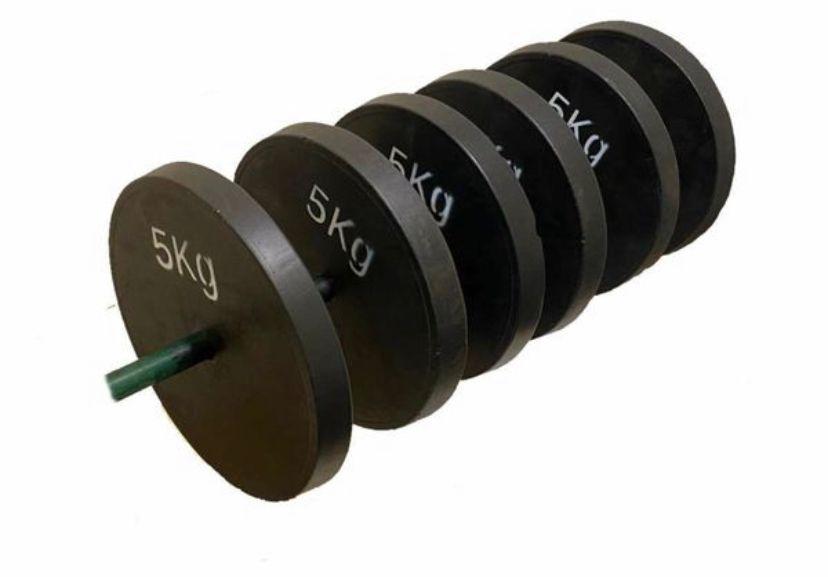
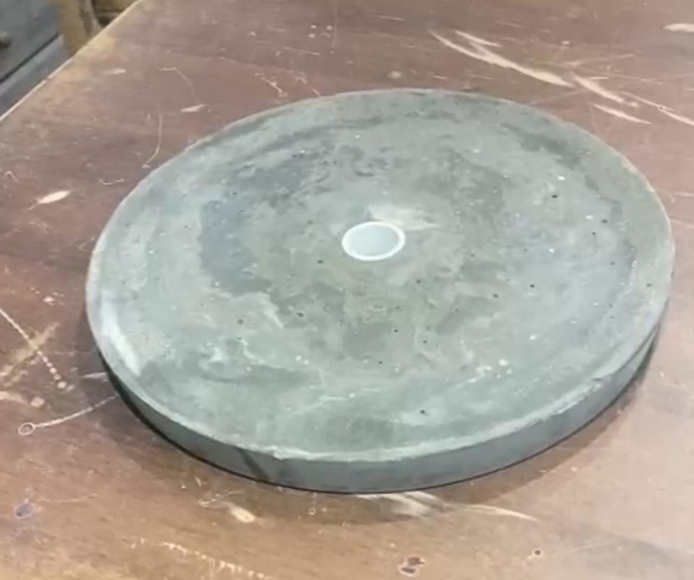
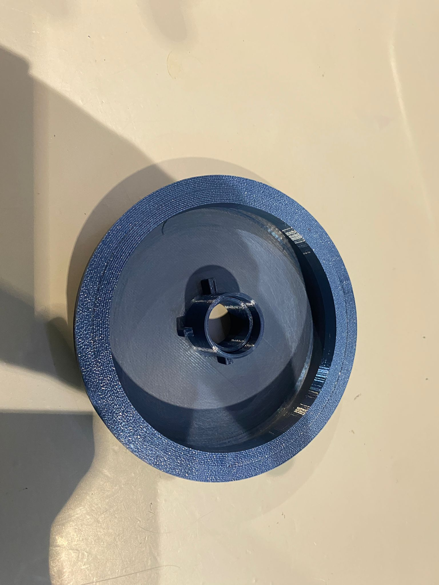
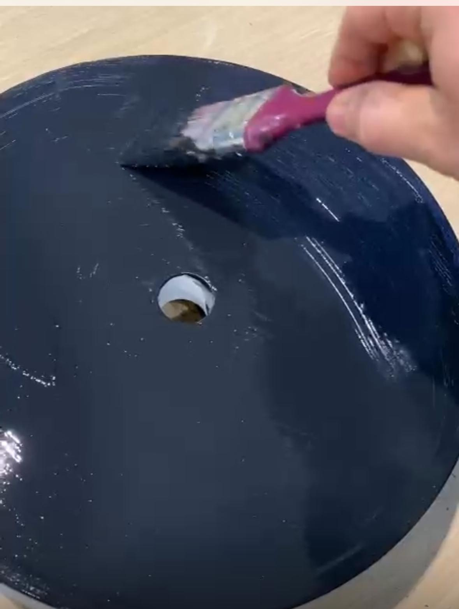
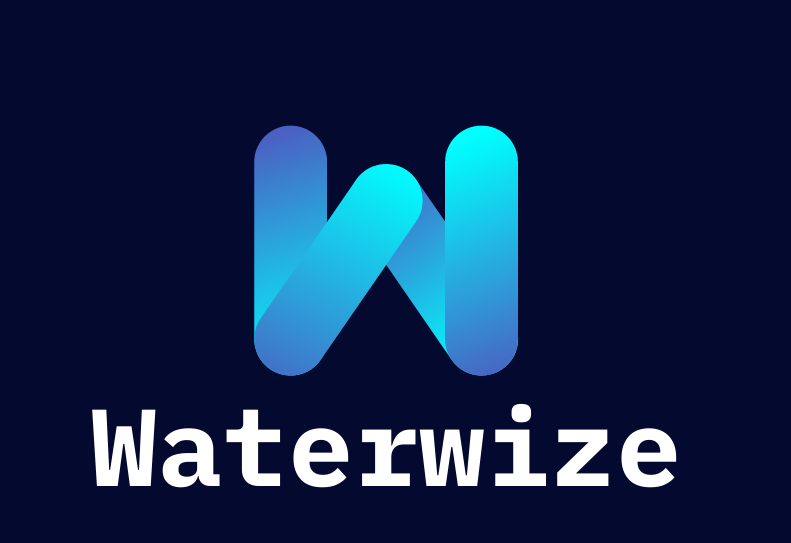

```{=html}
<div class="pf pf--venture">

<header class="pf-head">
  <div class="pf-title" role="heading" aria-level="1">Entrepreneurship</div>
  <p class="pf-lede">
    I like building things from the ground up, with limited resources and a lot of drive.
    Here is the business I co-founded, a venture project from my degree, and the work experience that taught me how businesses really run.
  </p>
</header>

<h2>EVCIM: recycled weights</h2>

<div class="pf-feature">
  <div class="pf-feature-media">
    
  </div>
  <div>
    <div class="pf-meta">Co-founder. Product design, manufacturing, outreach and automation.</div>
    <p>
      EVCIM turns scrap into affordable gym equipment. I co-founded it and handled everything from design and manufacturing
      to customer outreach and backend automation. It rests on one belief: fitness should be accessible to everyone,
      and weights shouldn't be expensive.
    </p>
    <div class="pf-actions">
      <a class="pf-btn pf-btn--primary" href="projects/EVCIM.qmd">Read the full story</a>
      <a class="pf-btn pf-btn--ghost" href="https://www.instagram.com/_evcim_" target="_blank">Follow EVCIM on Instagram</a>
    </div>
  </div>
</div>

<h3>How we make the weights</h3>

<ol class="pf-steps">
  <li>Recover metal springs from abandoned mattresses, then heat, straighten and cut them.</li>
  <li>Mix the metal with concrete to cast homemade weight plates.</li>
  <li>Coat the dried plates in matte black paint to finish the 5kg design. At first we could only produce six at a time.</li>
  <li>Develop moulds from recycled plastic so every plate comes out identical, and faster.</li>
  <li>Build a drying rack from discarded wooden planks so several weights can cure at once.</li>
</ol>

<div class="pf-gallery">
  <figure>
    
    <figcaption>An early plate: concrete reinforced with straightened mattress springs.</figcaption>
  </figure>
  <figure>
    
    <figcaption>A recycled-plastic mould for consistent, repeatable plates.</figcaption>
  </figure>
  <figure>
    
    <figcaption>Matte black paint gives each plate a clean finish.</figcaption>
  </figure>
</div>

<h2>WaterWize</h2>

<div class="pf-feature pf-feature--reverse">
  <div>
    <div class="pf-meta">Team venture project (NED). Health technology.</div>
    <p>
      WaterWize turns slow water testing into instant checks. The idea is a pocket-sized device that spots
      Legionella in seconds and sends the results to your phone: a Fitbit for your water system, always on and always watching.
    </p>
    <div class="pf-actions">
      <a class="pf-btn pf-btn--primary" href="pdfs/WaterWize.pdf" target="_blank">Read the full report</a>
    </div>
  </div>
  <div class="pf-feature-media">
    <a href="pdfs/WaterWize.pdf" target="_blank"></a>
  </div>
</div>

<h2>Work experience</h2>

<div class="pf-note">
  <h3>Golden Grill, Carlow: over 4 years</h3>
  <p>
    I worked at a family-owned Italian restaurant, gaining hands-on experience in customer service,
    stock management and kitchen operations during peak hours. It taught me the value of consistency, clear communication
    and staying calm under pressure.
  </p>
</div>

<h2>What's next</h2>

<p>
  I plan to launch my own cricket coaching business or cricket-related initiative, with a professional website as one of the first steps.
  <a href="Future.qmd">Read about my plans</a>.
</p>

<nav class="pf-switch" aria-label="Other sections">
  <a class="to-academic" href="academic.qmd">Academic</a>
  <a class="to-sport" href="sport.qmd">Sport</a>
</nav>

</div>
```
