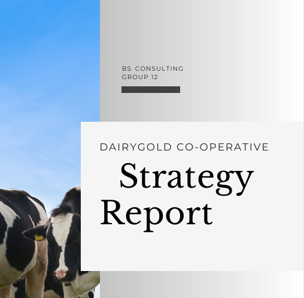
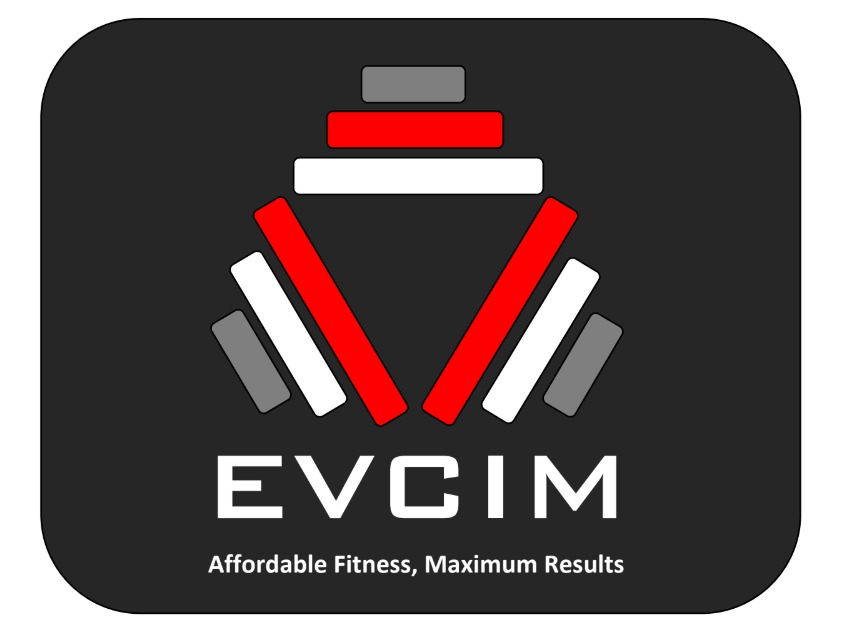
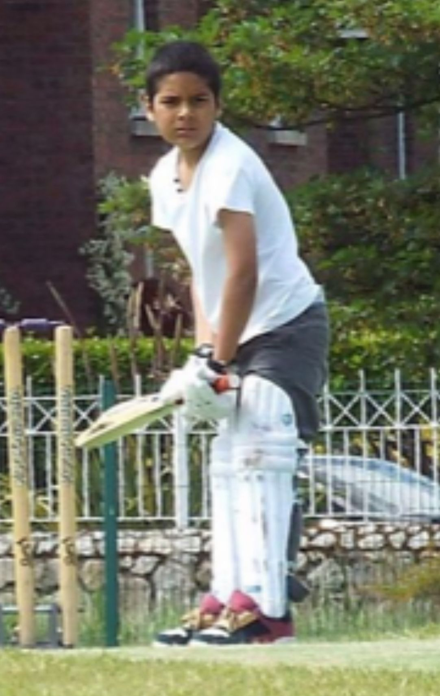

```{=html}
<div class="pf">

<section class="pf-hero">
  <div>
    <div class="pf-title" role="heading" aria-level="1">Laeeq Ur Rehman</div>
    <div class="pf-role">Business Studies &amp; Data Analytics student at DCU</div>
    <p class="pf-intro">
      I'm a final-year Business Studies student at DCU, specialising in Data Analytics.
      I lead on and off the field &mdash; as a club and university cricket captain, speaker, and coder.
      This portfolio brings together three sides of my story: what I've studied, what I've built, and how sport shapes me.
    </p>
    <div class="pf-actions">
      <a class="pf-btn pf-btn--primary" href="#explore">Explore my work</a>
      <a class="pf-btn pf-btn--ghost" href="Laeeq_CV.pdf" target="_blank">Download CV</a>
    </div>
    <div class="pf-social">
      <a href="https://github.com/Laeeq-1" target="_blank">GitHub</a>
      <a href="https://www.linkedin.com/in/laeeq-ur-rehman-2806192ab" target="_blank">LinkedIn</a>
      <a href="https://www.instagram.com/laeeq3x/" target="_blank">Instagram</a>
      <a href="mailto:Laeeq.urrehman2@mail.dcu.ie">Email</a>
    </div>
  </div>
  
</section>

<h2 id="explore">My Portfolio</h2>

<div class="pf-tiles">

  <a class="pf-tile pf-tile--academic" href="academic.qmd">
    
    <div class="pf-tile-body">
      <h3>Academic</h3>
      <p>Data analytics, supply chain strategy and machine learning projects from my degree at DCU.</p>
      <span class="pf-tile-cta">See my projects &rarr;</span>
    </div>
  </a>

  <a class="pf-tile pf-tile--venture" href="entrepreneurship.qmd">
    
    <div class="pf-tile-body">
      <h3>Entrepreneurship</h3>
      <p>EVCIM, the recycled-weights business I co-founded, plus the WaterWize venture project.</p>
      <span class="pf-tile-cta">See what I've built &rarr;</span>
    </div>
  </a>

  <a class="pf-tile pf-tile--sport" href="sport.qmd">
    
    <div class="pf-tile-body">
      <h3>Sport</h3>
      <p>Captaining on the pitch, and using code to analyse and improve my cricket.</p>
      <span class="pf-tile-cta">Follow my journey &rarr;</span>
    </div>
  </a>

</div>

<h2>At a Glance</h2>

<div class="pf-stats">
  <div class="pf-stat"><strong>12</strong><span>divisions climbed in one cricket season</span></div>
  <div class="pf-stat"><strong>567</strong><span>runs scored in the 2024 season</span></div>
  <div class="pf-stat"><strong>3</strong><span>captaincies: school hurling, club and university cricket</span></div>
  <div class="pf-stat"><strong>4+</strong><span>years working in a family restaurant</span></div>
</div>

<div class="pf-next">
  <h3>Want to know more?</h3>
  <p>
    Read <a href="about.qmd">my story</a>, browse my <a href="Skills.qmd">skills</a>,
    see my <a href="achievements.qmd">achievements</a>, or look at <a href="Future.qmd">where I'm heading next</a>.
  </p>
</div>

</div>
```
