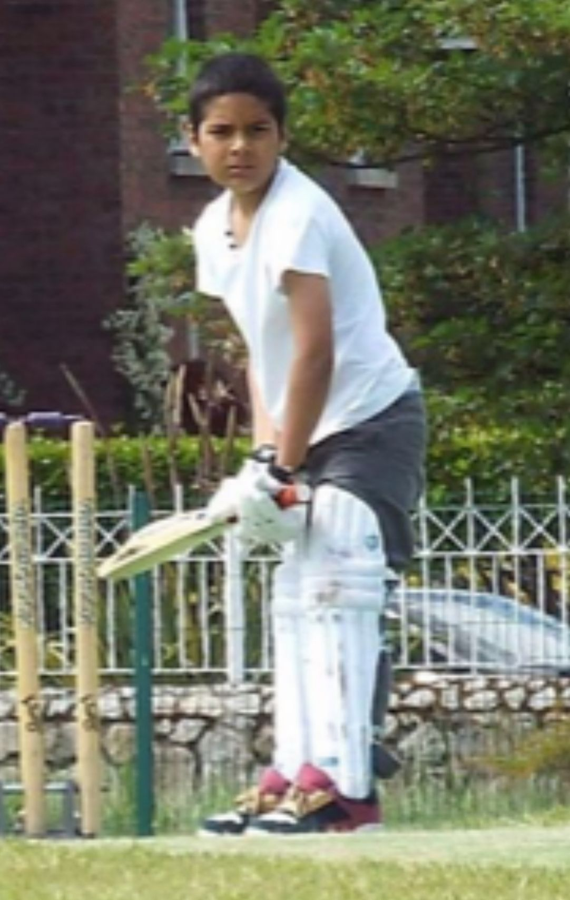
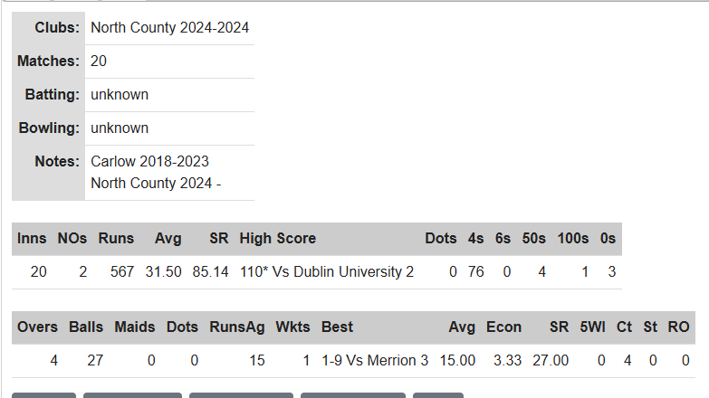
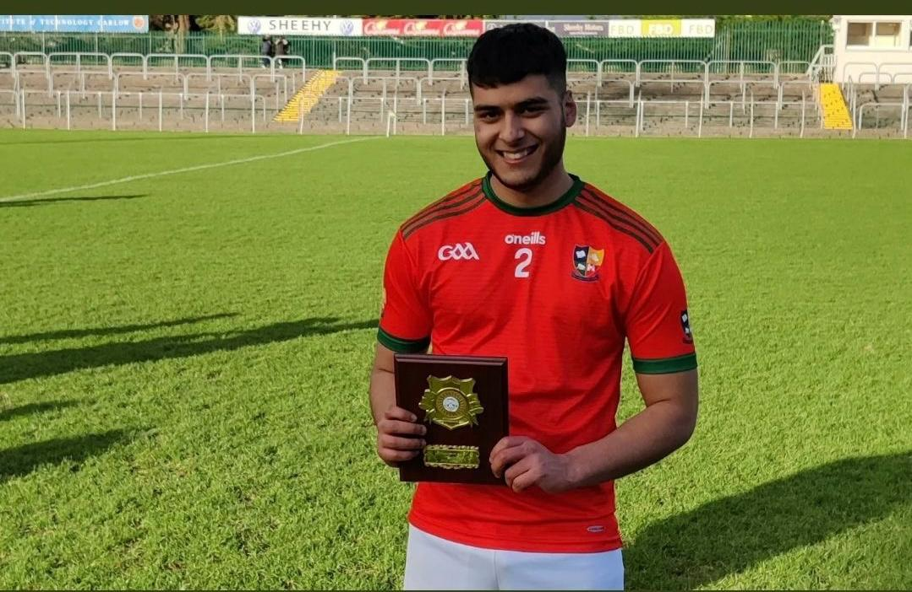

```{=html}
<div class="pf pf--sport">

<header class="pf-head">
  <div class="pf-title" role="heading" aria-level="1">Sport</div>
  <p class="pf-lede">
    Cricket has been a way of life since I can remember. It taught me discipline, leadership and resilience,
    and now I use code to study my game and keep improving.
  </p>
</header>

<h2>Cricket journey</h2>

<div class="pf-feature">
  <div class="pf-feature-media">
    
  </div>
  <div>
    <p>
      Every summer, whether in Ireland or visiting Pakistan, I'd spend hours playing with family and friends.
      Cricket was never just a game. It was a dream, and dreams demand hard work.
      I now analyse technique, review matches and work on both my physical game and my mental mindset.
    </p>
    <p>
      I represented Carlow in 2023 and moved to North County in 2024, a move about growth:
      higher-level cricket and pushing beyond my comfort zone.
    </p>
    <div class="pf-actions">
      <a class="pf-btn pf-btn--primary" href="projects/cricket-journey.qmd">See my cricket stats</a>
      <a class="pf-btn pf-btn--ghost" href="https://www.instagram.com/laeeq3x/" target="_blank">Follow me on Instagram</a>
    </div>
  </div>
</div>

<h3>Using data to get better</h3>

<div class="pf-feature pf-feature--reverse">
  <div>
    <p>
      I used Python to visualise my stats and study my dismissals. A high number of LBW dismissals in 2023 showed my head
      was falling across the stumps, so I worked on my alignment and balance to become more consistent.
      It helped me improve technically, mentally and tactically.
    </p>
  </div>
  <div class="pf-feature-media">
    <a href="projects/cricket-journey.qmd"></a>
  </div>
</div>

<h2>Leadership on the field</h2>

<div class="pf-feature">
  <div class="pf-feature-media">
    
  </div>
  <div>
    <h3>Captain of school hurling, club cricket and university cricket</h3>
    <p>
      As captain of the CBS hurling team, I led our school with pride and commitment. In my final year we won the
      South Leinster final, one of my most memorable moments from secondary school. The role taught me responsibility and communication
      on and off the field, and I now carry that into captaining club and university cricket teams.
    </p>
  </div>
</div>

<h2>Mindset</h2>

<p>
  These are podcasts I like. They delve into the mind of an athlete, tackle performance anxiety,
  and explore what separates the average from the best.
</p>

<div class="pf-videos">
  <iframe src="https://www.youtube.com/embed/QOsHNL6V8O8" title="Podcast 1" allowfullscreen loading="lazy"></iframe>
  <iframe src="https://www.youtube.com/embed/fJGYxQEpv6o" title="Podcast 2" allowfullscreen loading="lazy"></iframe>
  <iframe src="https://www.youtube.com/embed/VSceuiPBpxY" title="Podcast 3" allowfullscreen loading="lazy"></iframe>
</div>

<h2>What's next</h2>

<div class="pf-note">
  <h3>Going professional, and coaching</h3>
  <p>
    My next big goal is to pursue cricket professionally: training harder, pushing my physical and mental limits,
    and possibly training abroad for higher competition and better facilities. Longer term, I want to launch a cricket coaching business
    or cricket-related initiative. <a href="Future.qmd">Read more about my plans</a>.
  </p>
</div>

<nav class="pf-switch" aria-label="Other sections">
  <a class="to-academic" href="academic.qmd">Academic</a>
  <a class="to-venture" href="entrepreneurship.qmd">Entrepreneurship</a>
</nav>

</div>
```
